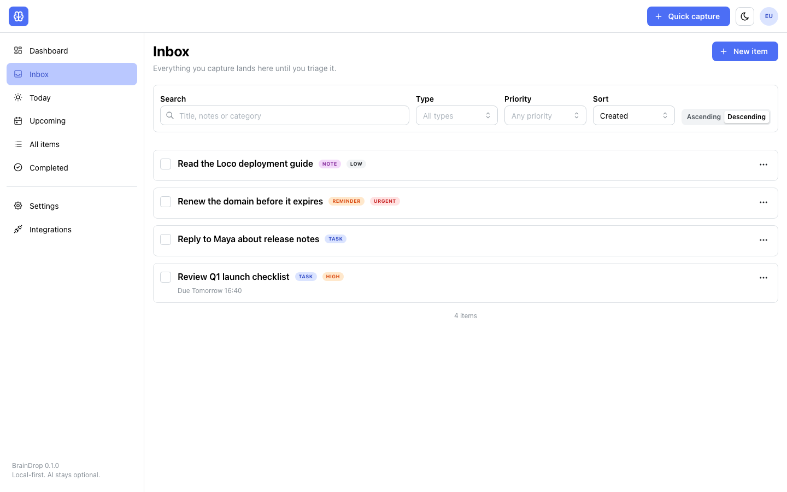
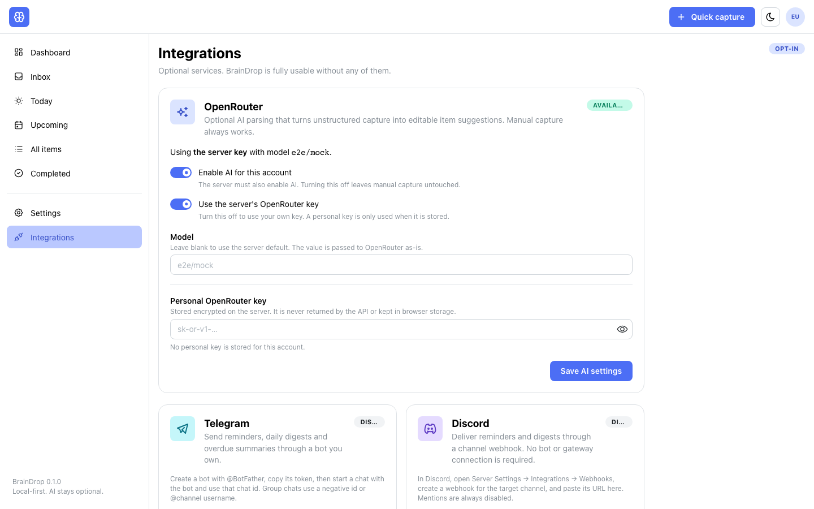

# BrainDrop

**A lightweight, self-hosted, AI-optional personal inbox.**

Capture thoughts, tasks, notes and reminders in one place. Drop in an
unstructured thought — *"Buy milk tomorrow, renew my domain on December 15,
and learn Rust async programming"* — and review the structured items BrainDrop
suggests.

AI is optional. Every core feature works without an API key or any external
service. **No AI, Telegram or Discord credentials are required for capture,
tasks, notes, ideas, reminders, search, statistics or settings.**

## Status

**BrainDrop v0.1.0 is prepared for release.** Local validation passed and the
authorized Fly.io and TierHive deployments are running. The tag, GitHub release
and container publication are awaiting approval. See
[`docs/releases/v0.1.0.md`](docs/releases/v0.1.0.md) for release notes and
[`docs/PROGRESS.md`](docs/PROGRESS.md) for validation status.

| Area | State |
|---|---|
| Loco scaffold, SQLite, SQLite-backed queue | Working |
| Loco JWT authentication | Working, with configurable registration, verification and endpoint rate limits |
| React + Mantine application shell | Working, installable PWA shell |
| Docker-first local CI (`./scripts/ci.sh`) | Working |
| Items, settings, dashboard stats | Working |
| Optional OpenRouter capture parser | Working — server key or encrypted per-user key |
| Telegram / Discord notifications | Working — opt-in reminders, daily digest and overdue summaries |
| Docker Compose deployment and backups | Working — production image, persistent volume, health check |
| Native binaries and SSH deployment | Working — six targets, Makefile, Alpine/Ubuntu services |
| Task 007 release hardening | Complete — security headers, no-store cache policy, auth rate limits, release docs and full Docker-first CI |
| Task 009 review remediation | Complete — atomic auth, bounded SQLite pools, generated API contracts, retry-safe notifications and safer backups/releases |
| Task 010 deployment validation | Fly.io and TierHive are running; TierHive public HTTPS now works through Cloudflare; some origin-proxy and authenticated checks remain unverified |

Current release line: **v0.1.0** — see
[`docs/releases/v0.1.0.md`](docs/releases/v0.1.0.md) and
[`CHANGELOG.md`](CHANGELOG.md). See [`docs/PROGRESS.md`](docs/PROGRESS.md) for
the current milestone and [`docs/tasks/`](docs/tasks/) for the full plan.

## Screenshots

These are screenshots of the running SPA, captured from a real authenticated
session. They are committed in `docs/screenshots/` and can be regenerated with
`CAPTURE_SCREENSHOTS=1 pnpm --dir frontend test:e2e`:

### Dashboard


### Inbox



### Quick capture


### Integrations



## Stack

- Rust (stable) and [Loco](https://loco.rs) 1.3.x
- Axum through Loco, SeaORM, SQLite (WAL)
- Single-process Rust backend with Loco workers and scheduler, SQLite-backed queue
- React 19, TypeScript, Vite, React Router
- [Mantine](https://mantine.dev) 9, Mantine Hooks / Dates / Notifications
- Tabler Icons and TanStack Query
- OpenRouter (optional), Telegram Bot API, Discord webhooks
- Docker and GitHub Actions

Multi-user accounts are supported. No Redis, PostgreSQL, message broker, vector
database or microservice is required.

## Quick start

### Prerequisites

- Rust stable (`rustup`)
- Node.js 20+ and pnpm
- Optional: the Loco generator CLI (`cargo install loco --locked`) and
  `sea-orm-cli` (`cargo install sea-orm-cli --locked`)

### Run locally

```sh
# 1. Install and build the SPA (Loco serves frontend/dist)
pnpm --dir frontend install
pnpm --dir frontend build

# 2. Start the app (runs migrations automatically in development)
cargo loco start
```

Open <http://localhost:5150>. The generated authentication routes live under
`/api/auth`; the React app is served from `/`.

For frontend development with hot reload, run the backend and Vite side by side:

```sh
cargo loco start          # terminal 1, http://localhost:5150
pnpm --dir frontend dev   # terminal 2, http://localhost:5173
```

Vite proxies `/api` to the backend port from `PORT` (default `5150`).

### Create the first account

Public registration is disabled by default. Create the first account with the
administrator task, which marks the account verified. Enter the password
without echo; stdin keeps it out of process arguments:

```sh
read -r -s -p "Admin password: " ADMIN_PASSWORD
printf '\n'
printf '%s\n' "$ADMIN_PASSWORD" | cargo loco task admin:create \
  email:admin@example.com name:"Admin" password_stdin:true
unset ADMIN_PASSWORD
```

For a running Compose deployment, use the same task inside the app container:

```sh
read -r -s -p "Admin password: " ADMIN_PASSWORD
printf '\n'
printf '%s\n' "$ADMIN_PASSWORD" | docker compose exec -T app \
  /usr/local/bin/braindrop-cli task admin:create \
  email:admin@example.com name:"Admin" password_stdin:true
unset ADMIN_PASSWORD
```

Set `ALLOW_REGISTRATION=true` to let visitors create their own accounts, and
`REQUIRE_EMAIL_VERIFICATION=true` to require a verified address before login.
Both are read from the environment through `config/<env>.yaml`.

Development email uses SMTP on `localhost:1025`. Run a local catcher such as
Mailpit if you want to receive verification and password-reset mail:

```sh
docker run --rm -p 1025:1025 -p 8025:8025 axllent/mailpit
```

### Optional AI capture

Manual capture never requires AI. Optional OpenRouter parsing suggests typed,
timezone-aware items for review before anything is saved. Users can bring a
personal API key, encrypted at rest and never returned to the browser. See the
[configuration guide](docs/DEPLOYMENT.md#6-configuration) and
[AI architecture notes](docs/ARCHITECTURE.md#8-openrouter-integration).

### Optional notifications

Per-user Telegram and Discord integrations can send reminders, daily digests
and overdue summaries. Credentials are encrypted at rest; durable delivery
records support deduplication and retries. Delivery is at-least-once, so a
duplicate can occur after an ambiguous provider failure. See the
[configuration guide](docs/DEPLOYMENT.md#6-configuration) and
[notification lifecycle](docs/ARCHITECTURE.md#9-notifications).

## Deployment

Supported deployment methods, all running the same application behavior:

```sh
# Docker (most installs)
cp .env.example .env       # set JWT_SECRET and HOST
docker compose up -d

# Native build and archive
make build-alpine-amd64
./scripts/package.sh x86_64-unknown-linux-musl

# SSH release flow (no Docker or compiler on the server)
make deploy-init  SSH_HOST=server.example.com SSH_USER=root OS=alpine
make deploy-linux SSH_HOST=server.example.com SSH_USER=deploy OS=ubuntu ARCH=arm64

# Optional Fly.io Docker deployment (requires flyctl auth login)
make fly-init
make fly-deploy
```

After publication, use the prebuilt multi-architecture Docker image with the
existing Compose configuration:

```sh
BRAINDROP_IMAGE=ghcr.io/newmizanur/braindrop:v0.1.0 docker compose pull app
BRAINDROP_IMAGE=ghcr.io/newmizanur/braindrop:v0.1.0 docker compose up -d --no-build
```

Native release archives include the binary, production config, compiled
frontend and backup/restore helpers. Download the matching Linux musl/glibc or
macOS ARM64/x86_64 archive from the
[GitHub Releases page](https://github.com/newmizanur/braindrop/releases), then
follow [DEPLOYMENT.md](docs/DEPLOYMENT.md). SSH deployment installs the
appropriate Alpine/OpenRC or Ubuntu/systemd service.

Docker Compose is the default always-on path. Native deployment uses Alpine /
OpenRC or Ubuntu / systemd archives; Fly.io is an optional managed Docker path
with an idle-stopping demo profile.

The runtime is one process (`start --all`) with separate application and queue
SQLite files on persistent storage. Native targets are musl and glibc Linux
(AMD64/ARM64) and macOS (Apple Silicon/Intel); Alpine/OpenRC and Ubuntu/systemd
service installers are included. Backups use SQLite's online backup API and are
restore-tested in CI.

See [`docs/DEPLOYMENT.md`](docs/DEPLOYMENT.md) for the full contract, security
checklist, upgrade/rollback flow and validation status.

### Measured resource use

Recent samples observed about **17.1 MiB native process RSS** on an Alpine VPS,
**23.4 MiB process RSS** on the Fly.io Docker machine, and **12.7 MiB sampled
container memory** for a small local Docker workload. These use different
measurement methods and environments. They are not minimum-memory or
production-capacity claims. See [`docs/BENCHMARK.md`](docs/BENCHMARK.md) for
methodology, latency results and limitations.

## Validation

Run ./scripts/ci.sh for the complete Docker-based Rust, frontend,
persistence, backup/restore, production-image and Playwright checks. GitHub
Actions remains manual-only and calls this same script.

## Documentation

- [`docs/ARCHITECTURE.md`](docs/ARCHITECTURE.md) — how the system is put together
- [`docs/DEPLOYMENT.md`](docs/DEPLOYMENT.md) — installation, configuration, upgrades and backups
- [`docs/BENCHMARK.md`](docs/BENCHMARK.md) — SQLite pool results and measurement limits
- [`docs/releases/v0.1.0.md`](docs/releases/v0.1.0.md) — release notes and checklist
- [`CHANGELOG.md`](CHANGELOG.md) — release history
- [`SECURITY.md`](SECURITY.md) — supported version and vulnerability reporting
- [`CONTRIBUTING.md`](CONTRIBUTING.md) — development workflow and conventions
- [`CODE_OF_CONDUCT.md`](CODE_OF_CONDUCT.md) — community expectations

## Security

Production requires explicit database URLs, a base64 JWT secret and public
HOST configuration. Registration is disabled by default; create the first
account with the admin task. User data is owner-scoped, API responses are
no-store, and the app sets a strict CSP. OpenRouter keys and notification
credentials are encrypted at rest and never returned by the API.

The frontend keeps JWTs in localStorage, so an XSS flaw could expose a session.
Rate-limit counters are in memory and reset on restart. Notification delivery
is at-least-once, and SQLite supports one application replica. Review the
[security policy](SECURITY.md) and [deployment security checklist](docs/DEPLOYMENT.md#11-security-checklist)
before exposing an instance to the Internet.

## License

MIT — see [`LICENSE`](LICENSE).
