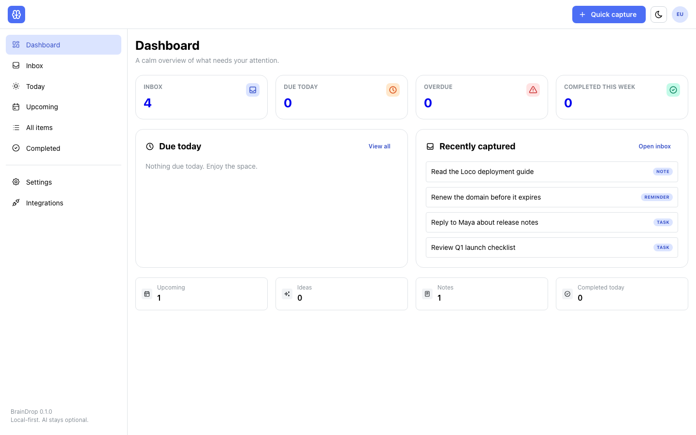
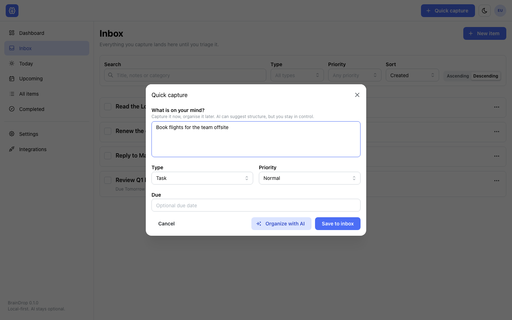

# BrainDrop

**Capture anything. Organize automatically.**

BrainDrop is an open-source, lightweight, self-hostable personal inbox, task and
reminder manager. Drop in an unstructured thought — *"Buy milk tomorrow, renew my
domain on December 15, and learn Rust async programming"* — and BrainDrop turns
it into structured items you can review, edit and save.

AI is optional. Every core feature works without an API key or any external
service. **No AI, Telegram or Discord credentials are required for capture,
tasks, notes, ideas, reminders, search, statistics or settings.**

## Status

**Implementation and Task 009 review remediation for v0.1.0 are complete.**
Final validation and packaging are recorded in [`docs/PROGRESS.md`](docs/PROGRESS.md).
Tagging, publishing and deployment have not happened and require explicit
authorization.

| Area | State |
|---|---|
| Loco scaffold, SQLite, SQLite-backed queue | Working |
| Loco JWT authentication | Working, with configurable registration, verification and endpoint rate limits |
| React + Mantine application shell | Working, installable PWA shell |
| Docker-first local CI (`./scripts/ci.sh`) | Working |
| Items, settings, dashboard stats | Working |
| Optional OpenRouter capture parser | Working — server key or encrypted per-user key |
| Telegram / Discord notifications | Working — opt-in reminders, daily digest and overdue summaries |
| Docker Compose deployment and backups | Working — production image, persistent volume, health check |
| Native binaries and SSH deployment | Working — six targets, Makefile, Alpine/Ubuntu services |
| Task 007 release hardening | Complete — security headers, no-store cache policy, auth rate limits, release docs and full Docker-first CI |
| Task 009 review remediation | Complete — atomic auth, bounded SQLite pools, generated API contracts, retry-safe notifications and safer backups/releases |
| Task 010 deployment validation | Fly.io is running; TierHive OpenRC is running after the owner corrected an executable permission issue; final authenticated and resource checks are in progress |

Current release line: **v0.1.0** — see
[`docs/releases/v0.1.0.md`](docs/releases/v0.1.0.md) and
[`CHANGELOG.md`](CHANGELOG.md). See [`docs/PROGRESS.md`](docs/PROGRESS.md) for
the current milestone and [`docs/tasks/`](docs/tasks/) for the full plan.

## Screenshots

These are screenshots of the running SPA, captured from a real authenticated
session. They are committed in `docs/screenshots/` and can be regenerated with
`CAPTURE_SCREENSHOTS=1 pnpm --dir frontend test:e2e`:

### Dashboard



### Inbox


### Quick capture



### Integrations


## Stack

- Rust (stable) and [Loco](https://loco.rs) 1.3.x
- Axum through Loco, SeaORM, SQLite (WAL)
- Loco native workers and scheduler, SQLite-backed queue
- React 19, TypeScript, Vite, React Router
- [Mantine](https://mantine.dev) 9, Mantine Hooks / Dates / Notifications
- Tabler Icons and TanStack Query
- OpenRouter (optional), Telegram Bot API, Discord webhooks
- Docker and GitHub Actions

No Redis, PostgreSQL, message broker, vector database or microservice is
required.

## Quick start

### Prerequisites

- Rust stable (`rustup`)
- Node.js 20+ and pnpm
- Optional: the Loco generator CLI (`cargo install loco --locked`) and
  `sea-orm-cli` (`cargo install sea-orm-cli --locked`)

### Run locally

```sh
# 1. Install and build the SPA (Loco serves frontend/dist)
pnpm --dir frontend install
pnpm --dir frontend build

# 2. Start the app (runs migrations automatically in development)
cargo loco start
```

Open <http://localhost:5150>. The generated authentication routes live under
`/api/auth`; the React app is served from `/`.

For frontend development with hot reload, run the backend and Vite side by side:

```sh
cargo loco start          # terminal 1, http://localhost:5150
pnpm --dir frontend dev   # terminal 2, http://localhost:5173
```

Vite proxies `/api` to the backend port from `PORT` (default `5150`).

### Create the first account

Public registration is disabled by default. Create the first account with the
administrator task, which marks the account verified. Enter the password
without echo; stdin keeps it out of process arguments:

```sh
read -r -s -p "Admin password: " ADMIN_PASSWORD
printf '\n'
printf '%s\n' "$ADMIN_PASSWORD" | cargo loco task admin:create \
  email:admin@example.com name:"Admin" password_stdin:true
unset ADMIN_PASSWORD
```

Set `ALLOW_REGISTRATION=true` to let visitors create their own accounts, and
`REQUIRE_EMAIL_VERIFICATION=true` to require a verified address before login.
Both are read from the environment through `config/<env>.yaml`.

Development email uses SMTP on `localhost:1025`. Run a local catcher such as
Mailpit if you want to receive verification and password-reset mail:

```sh
docker run --rm -p 1025:1025 -p 8025:8025 axllent/mailpit
```

### Optional AI capture

AI is opt-in and entirely optional. Manual capture keeps working with no key.
To enable the server-wide OpenRouter integration, set:

```env
AI_ENABLED=true
OPENROUTER_API_KEY=sk-or-v1-...
OPENROUTER_MODEL=openai/gpt-4o-mini
OPENROUTER_BASE_URL=https://openrouter.ai/api/v1
# Optional: lets users store their own encrypted OpenRouter key
AI_ENCRYPTION_KEY=<output of `openssl rand -base64 32`>
```

`AI_TIMEOUT_SECONDS`, `AI_MAX_INPUT_CHARS` and `AI_RATE_LIMIT_PER_MINUTE` bound
provider requests. The model is never hardcoded: choose the server default with
`OPENROUTER_MODEL`, and let users override it on the Integrations page.

Users can either use the server key or store a personal key. Personal keys are
sealed with AES-256-GCM using `AI_ENCRYPTION_KEY`, are never returned by the API
and never reach browser storage. Without `AI_ENCRYPTION_KEY`, the server key
path still works; users simply cannot save a personal key. The base URL is
server configuration only and is never user-configurable.

Captured text and suggestions are sent to the selected provider. The prompt
includes the user's timezone and local date so relative dates resolve correctly,
and treats the capture text as untrusted data rather than instructions. Nothing
is persisted until the user reviews the suggestions and saves the ones they
want.

### Optional notifications

Notifications are opt-in, per user, and independent for Telegram and Discord.
Both channels are off until the user enables them and stores credentials on the
Integrations page. BrainDrop never needs a bot gateway connection: Telegram uses
the Bot API and Discord uses a channel webhook.

```env
# Optional: falls back to AI_ENCRYPTION_KEY when empty
NOTIFICATION_ENCRYPTION_KEY=<output of `openssl rand -base64 32`>
NOTIFICATION_TIMEOUT_SECONDS=10
NOTIFICATION_MAX_ATTEMPTS=5
NOTIFICATION_RETRY_BASE_SECONDS=30
NOTIFICATION_RETRY_MAX_SECONDS=3600
NOTIFICATION_HISTORY_RETENTION_DAYS=30
NOTIFICATION_TEST_RATE_LIMIT=5
```

Users choose scheduled reminders, a daily digest at a local delivery time and
grouped overdue notifications in Settings. The digest and overdue schedules use
the account timezone. Empty digests are skipped. Completed, archived and deleted
items are never sent, and a reminder that is edited before delivery is cancelled.

Every intended delivery is written to `notification_deliveries` before a queue
job is enqueued. A unique deduplication key makes repeated scheduler scans safe,
and a recovery scan requeues pending or abandoned deliveries after a restart.
Delivery is **at-least-once**: providers do not offer exactly-once semantics, so
a retry after an ambiguous network failure can produce a duplicate message.

Telegram tokens and Discord webhook URLs are sealed with AES-256-GCM, are never
returned by the API and never reach browser storage. Outbound requests are
restricted to the official Telegram API and Discord webhook hosts; redirects are
disabled. The `POST /api/notifications/test` endpoint is rate-limited per user.
See [`docs/ARCHITECTURE.md`](docs/ARCHITECTURE.md#9-notifications) for the
delivery lifecycle.

## Commands

| Command | Purpose |
|---|---|
| `cargo loco start` | Run the HTTP server |
| `cargo loco start --worker` | Run a background worker process |
| `cargo loco start --scheduler` | Run the scheduler process |
| `cargo loco start --all` | Run server, worker and scheduler together |
| `cargo loco routes` | List registered routes |
| `cargo loco db migrate` | Apply migrations |
| `cargo loco db entities` | Regenerate SeaORM entities from the schema |
| `cargo loco task <name>` | Run a CLI task |
| `cargo loco doctor` | Diagnose environment and configuration |
| `pnpm --dir frontend build` | Type-check and build the SPA into `frontend/dist` |
| `pnpm --dir frontend lint` | ESLint |
| `pnpm --dir frontend test` | Vitest |
| `pnpm --dir frontend exec playwright test` | Playwright smoke tests |
| `./scripts/ci.sh` | Run the complete Docker CI pipeline |
| `make help` | List build, packaging and deployment targets |
| `make build-all` | Build all six native release targets |
| `make deploy-init` / `make deploy-linux` | First install / update over SSH |

## Deployment

Supported deployment methods, all running the same application behavior:

```sh
# Docker (most installs)
cp .env.example .env       # set JWT_SECRET and HOST
docker compose up -d

# Native build and archive
make build-alpine-amd64
./scripts/package.sh x86_64-unknown-linux-musl

# SSH release flow (no Docker or compiler on the server)
make deploy-init  SSH_HOST=server.example.com SSH_USER=root OS=alpine
make deploy-linux SSH_HOST=server.example.com SSH_USER=deploy OS=ubuntu ARCH=arm64

# Optional Fly.io Docker deployment (requires flyctl auth login)
make fly-init
make fly-deploy
```

Docker Compose is the default always-on path. Native deployment uses Alpine /
OpenRC or Ubuntu / systemd archives; Fly.io is an optional managed Docker path
with an idle-stopping demo profile.

The runtime is one process (`start --all`) with separate application and queue
SQLite files on persistent storage. Native targets are musl and glibc Linux
(AMD64/ARM64) and macOS (Apple Silicon/Intel); Alpine/OpenRC and Ubuntu/systemd
service installers are included. Backups use SQLite's online backup API and are
restore-tested in CI.

See [`docs/DEPLOYMENT.md`](docs/DEPLOYMENT.md) for the full contract, security
checklist, upgrade/rollback flow and validation status.

Task 009's local pool comparison reached 1,502 requests/second at pool max 4
with 37 MB sampled process RSS. This is a synthetic single-host result, not a
capacity or 128/256 MiB reliability claim; see [`docs/BENCHMARK.md`](docs/BENCHMARK.md)
for the method and limitations.

## Continuous integration

`./scripts/ci.sh` is the single validation entry point. It builds the CI and
production images with `docker-compose.ci.yml` and runs, in order:

1. Rust formatting, Clippy, tests and a clean SQLite migration, plus the
   backup/restore self-test, deploy argument validation and package layout
   checks.
2. Frontend type-check, lint, unit tests and production build.
3. The production Docker image, including `/_health`, plus a log check that Loco
   started the HTTP server, worker and scheduler (`start --all`).
4. A persistence probe: create an item through the API, restart the container,
   confirm the item survived, and run an in-container SQLite backup.
5. Playwright smoke tests against that image.

Cargo caches live in named Docker volumes and the pnpm store in a BuildKit cache
mount, so repeated runs are fast. Test databases are created inside containers;
development and production data are never mounted.

GitHub Actions is intentionally **manual-only** (`workflow_dispatch`) for now
and calls the same script, so local and hosted runs cannot drift.

## Project layout

```text
src/                 Loco backend (controllers, models, workers, tasks, mailers)
migration/           SeaORM migrations
config/              development / test / production configuration
frontend/            React + Mantine SPA (built into frontend/dist)
tests/               Loco request, model, task and worker tests
docker/ci/           Dockerfiles for the CI stages
docker/native/       glibc release toolchain image
scripts/             CI, build, package, deploy, backup and restore scripts
Makefile             local, build, package and deploy entry points
docs/                specification, architecture, progress, deployment, tasks
```

## Documentation

- [`docs/SPEC.md`](docs/SPEC.md) — product and technical specification
- [`docs/ARCHITECTURE.md`](docs/ARCHITECTURE.md) — how the system is put together
- [`docs/PROGRESS.md`](docs/PROGRESS.md) — milestone status and handoff notes
- [`docs/DEPLOYMENT.md`](docs/DEPLOYMENT.md) — production deployment plan
- [`docs/BENCHMARK.md`](docs/BENCHMARK.md) — SQLite pool results and measurement limits
- [`docs/tasks/010-deployment-validation.md`](docs/tasks/010-deployment-validation.md) — Task 010 deployment validation record
- [`docs/tasks/`](docs/tasks/) — milestone-by-milestone implementation plan
- [`docs/releases/v0.1.0.md`](docs/releases/v0.1.0.md) — release notes and checklist
- [`CHANGELOG.md`](CHANGELOG.md) — release history
- [`SECURITY.md`](SECURITY.md) — supported version and vulnerability reporting
- [`CONTRIBUTING.md`](CONTRIBUTING.md) — development workflow and conventions
- [`CODE_OF_CONDUCT.md`](CODE_OF_CONDUCT.md) — community expectations
- [`AGENTS.md`](AGENTS.md) — contributor and agent guide for this repository

## Security

- All application data is scoped to the authenticated user; another user's row
  returns 404, and unknown API routes return JSON rather than the SPA.
- Never commit `.env` files, database files, tokens or provider credentials.
- Production requires `DATABASE_URL`, `QUEUE_URL`, `JWT_SECRET` and `HOST` to be
  supplied explicitly; there are no production defaults for secrets.
  `JWT_SECRET` must be base64, because Loco decodes it before signing.
- Public registration is disabled by default; the first account is created with
  `admin:create`. Authentication endpoints have in-process rate limits keyed by
  account and client address (see `REMOTE_IP_SOURCE` in `.env.example`).
- Every response carries a strict Content-Security-Policy and supporting
  security headers. `/api/*`, monitoring paths and HTML documents are sent with
  `Cache-Control: no-store`; the service worker never caches them either.
- AI and notification integrations are optional, fail gracefully, and are not
  needed for core features.
- Personal OpenRouter keys are encrypted at rest with `AI_ENCRYPTION_KEY` and
  are never returned by the API, written to logs or stored in the browser.
  Without `AI_ENCRYPTION_KEY`, only the server key can be used. The OpenRouter
  client disables redirects so a key cannot be sent to a redirect target.
- Telegram bot tokens and Discord webhook URLs are sealed with
  `NOTIFICATION_ENCRYPTION_KEY` (or `AI_ENCRYPTION_KEY`), are write-only in the
  API and are never logged. Outbound hosts are restricted to the official
  provider endpoints.

### Public exposure and residual risks

If the service is reachable from the Internet (public `HOST`, forwarded port),
terminate TLS at a trusted reverse proxy, restrict the application port to that
proxy, set `HOST` to the public HTTPS origin, and add edge rate limiting. BrainDrop
does **not** send HSTS — configure `Strict-Transport-Security` at the proxy.
`REMOTE_IP_SOURCE` defaults to `ConnectInfo`; use `RightmostXForwardedFor` only
behind one trusted proxy that overwrites `X-Forwarded-For`, never on a header a
client can supply. See [`SECURITY.md`](SECURITY.md) and the
[deployment security checklist](docs/DEPLOYMENT.md#11-security-checklist).

Known residual risks and compensating controls:

| Residual risk | Compensating control |
|---|---|
| The generated SPA stores its JWT in `localStorage`; any XSS can read it. | Strict CSP with no inline/eval scripts, `no-store` on private responses, a service worker that bypasses API paths, no secrets in responses or logs, and `JWT_SECRET` rotation to invalidate sessions if needed. |
| Rate-limit counters are in memory and reset on restart. | Edge rate limiting at the reverse proxy; one application replica only. |
| No HSTS from the application. | HSTS configured at the TLS-terminating proxy or load balancer. |
| Notification delivery is at-least-once, not exactly-once. | Durable delivery rows and deduplication keys; duplicate provider delivery remains possible after an ambiguous failure. |
| SQLite is single-writer and has no horizontal scaling. | Single-replica deployment with online backup/restore scripts. |

## License

MIT — see [`LICENSE`](LICENSE).
